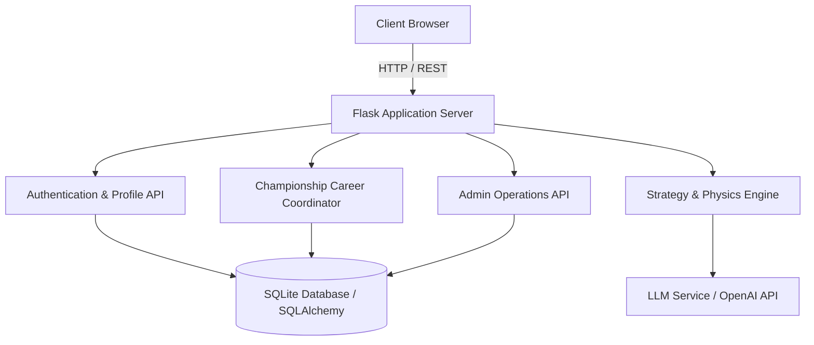

# 🏎️ F1 2026 Performance Simulator & AI Strategy Engine

[](https://python.org)
[](https://flask.palletsprojects.com/)
[](https://sqlite.org)
[](https://developer.mozilla.org)
[](https://formula1.com)

A state-of-the-art **Formula 1 2026 Season Performance & AI Race Strategy Simulator**. Built to model upcoming 2026 FIA technical regulations, active aerodynamics, electrical power deployment, tire compound thermal degradation, and championship progression.

---

## 🌟 Key Features

### 🏎️ 1. My Team Constructor Command
- **Authentic 2026 Grid**: Select from official constructors (*Oracle Red Bull Racing, McLaren Mastercard, Scuderia Ferrari HP, Mercedes-AMG Petronas, Aston Martin Aramco, Cadillac Formula 1*, and more).
- **Technical Specifications**: Power unit architecture, team principals, chassis aerodynamics, and high-resolution 2026 car renders.
- **2026 Pilot Lineup**: Interactive driver profiles featuring official photography, car number badges, driver stats, and ratings.
- **Action Portals**: Instant launchpad cards to jump directly into the **AI Strategy Analyzer**, **My Team Career Mode**, or **Driver Profile**.

### ⚡ 2. AI Race Strategy Analyzer
- **Circuit Telemetry**: Supports the complete 24-round 2026 FIA World Championship calendar.
- **Multi-Factor Physics Model**:
  - Downforce level (Low / Medium / High)
  - Drag aerodynamic coefficient
  - Tire compound degradation curves (Soft, Medium, Hard, Intermediate, Wet)
  - 2026 MGU-K electrical energy deployment & efficiency
  - Straight-line top speed vs. cornering velocity trade-offs
  - Dynamic track and weather conditions (Dry / Mixed / Wet)
- **AI-Powered Tactical Stints**: High-fidelity pit-stop window optimization, undercut/overcut predictions, lap time deltas, and LLM-assisted race engineering briefings.

### 🏆 3. 2026 World Championship Career Mode
- **Full Season Progression**: Compete across 24 official Grand Prix rounds from Bahrain to Abu Dhabi.
- **Realistic Race Simulation**:
  - Full qualifying sessions determining authentic grid positions.
  - Race coordinator simulating lap-by-lap overtakes, safety car periods, weather transitions, and pit stops.
  - Official FIA points system (including fastest lap bonus points).
  - Dynamic Drivers' and Constructors' Championship leaderboards.
- **Current vs. Next Race Intelligence**: Inspect pace deltas, expected track characteristics, and competitor comparisons.

### 🛠️ 4. Car Development & R&D Upgrade Shop
- **Performance Feedback Loop**: Earn **Development Points (DP)** from race results, podiums, wins, and milestone bonuses.
- **Departmental Upgrades**: Invest DP into Aerodynamics, Chassis, Power Unit / Energy Efficiency, Reliability, and Tire Management.
- **Live Physics Impact**: Car upgrades directly enhance the vehicle's baseline attributes, feeding into subsequent qualifying and race simulation engines.

### 🪪 5. Driver Profile & Super License Credentials
- **Live Championship Snapshot**: Track current driver position, points tally, wins, and podium finishes.
- **Development Points Accounting**: Real-time breakdown of available DP vs. total DP invested in car upgrades.
- **Credentials Management**: Update your official **Driver Callsign (Username)** and **Email Address** with instant database validation and session persistence.

### 📊 6. Operations Admin Command Console
- **Real-Time KPI Metrics**: Total registered accounts, active drivers, total Grand Prix races simulated, and average championship rounds completed.
- **Registry & Telemetry Inspector**: Searchable user registry table with deep telemetry inspection modals for inspecting driver careers and technical performance.

### 🎨 7. Premium Cyber / Glassmorphic UI
- **Aesthetic Excellence**: Dark cyber glassmorphism (`rgba(9, 14, 30, 0.85)`), racing accent lines, glowing borders, and typography ([Orbitron](https://fonts.google.com/specimen/Orbitron) + [Rajdhani](https://fonts.google.com/specimen/Rajdhani)).
- **Segregated View Architecture**: Clean view containers with smooth transitions—no cluttered, endless scrolling.

---

## 🏗️ Architecture & Tech Stack



| Layer | Technologies |
|---|---|
| **Backend** | Python 3.10+, Flask 3.1.3, Flask-SQLAlchemy 3.1.1, Werkzeug, Python-Dotenv |
| **Database** | SQLite with SQLAlchemy ORM (Users, Teams, Drivers, Careers, Upgrades, Simulation Logs) |
| **AI / LLM** | OpenAI API / Gemini API integration for tactical strategy narrative generation |
| **Frontend** | Vanilla JavaScript (ES6 Modules), Vanilla CSS3 (Custom design system), HTML5 Semantic markup |
| **Fonts & Icons** | Google Fonts (Orbitron, Rajdhani), Custom SVG vectors |

---

## 📁 Repository Structure

```
f1-ai-engine/
├── backend/
│   ├── app.py                     # Flask application factory & static file server
│   ├── config.py                  # Database & session configuration
│   ├── extensions.py              # SQLAlchemy extension registry
│   ├── models/                    # Database models (User, Team, Driver, Career, Upgrade)
│   ├── routes/
│   │   ├── admin_routes.py        # Operations console KPIs & user registry endpoints
│   │   ├── auth_routes.py         # Login, register, profile update & session endpoints
│   │   ├── career_routes.py       # Championship career start, race simulation & upgrade shop
│   │   ├── strategy_routes.py     # AI strategy simulation & tire calculation endpoints
│   │   ├── team_routes.py         # Constructor metadata & roster endpoints
│   │   └── circuit_routes.py      # Circuit telemetry & track endpoints
│   ├── services/
│   │   ├── strategy_engine.py     # Aerodynamic & stint optimization physics algorithms
│   │   ├── upgrade_engine.py      # R&D points calculation & car development logic
│   │   └── llm_service.py         # Generative AI strategy summaries & tactics
│   └── simulation/
│       ├── race_coordinator.py    # Full Grand Prix race engine with weather & safety cars
│       ├── race_simulator.py      # Lap delta and overtaking probability calculation
│       ├── qualifying.py          # 2026 qualifying pace & grid position generator
│       └── weather_engine.py      # Dynamic track wetness & rainfall progression
├── database/
│   └── f1.db                      # SQLite relational database
├── frontend/
│   ├── index.html                 # High-impact landing page & overview
│   ├── login.html                 # Driver registration, sign-in & team selection
│   ├── dashboard.html             # Main dashboard (My Team, Strategy, Career, Profile, Admin)
│   ├── data.js                    # Constructor & driver baseline data
│   ├── css/
│   │   ├── base.css               # Design tokens, variables & typography
│   │   ├── layout.css             # Fixed navbar & responsive view containers
│   │   ├── hero.css               # Constructor presentation & 2026 car display
│   │   ├── drivers.css            # Driver lineup cards & pilot badges
│   │   ├── strategy.css           # Strategy inputs, tire stint charts & telemetry
│   │   ├── career.css             # Championship dashboard, race comparison & R&D shop
│   │   ├── profile.css            # Driver credentials form, KPI metrics & action portals
│   │   ├── other-teams.css        # All constructors competitor grid
│   │   ├── admin.css              # Operations console, metrics & inspect modal
│   │   └── motion.css             # Transitions & micro-interactions
│   └── js/
│       ├── app.js                 # Application bootstrap & URL view routing
│       ├── navigation.js          # Segregated view controller & navbar states
│       ├── teams.js               # Constructor hero renderer & team switcher modal
│       ├── strategy.js            # Strategy simulation client & result visualizer
│       ├── career.js              # Career race runner, upgrades buyer & tab manager
│       ├── profile.js             # Driver profile loader & credential update form
│       ├── admin.js               # Admin KPI fetcher, search filter & user inspector
│       ├── config.js              # Client configuration & API base URLs
│       ├── state.js               # Reactive client state store
│       └── utils.js               # HTML sanitizer & DOM helpers
├── requirements.txt               # Python package dependencies
└── README.md                      # Complete project documentation
```

---

## 🚀 Quick Start & Installation

### 1. Prerequisites
- **Python**: Version `3.10` or higher installed.
- **Git**: Installed and configured.

### 2. Clone the Repository
```bash
git clone https://github.com/sathvikkk-19/F1-AI-Performance-Analyzer.git
cd F1-AI-Performance-Analyzer
```

### 3. Create and Activate Virtual Environment
```bash
# Windows (PowerShell)
python -m venv venv
.\venv\Scripts\Activate.ps1

# macOS / Linux
python3 -m venv venv
source venv/bin/activate
```

### 4. Install Dependencies
```bash
pip install -r requirements.txt
```

### 5. Configure Environment Variables
Create a `.env` file in the project root:
```ini
FLASK_ENV=development
SECRET_KEY=f1-secret-telemetry-key-2026
OPENAI_API_KEY=your_openai_api_key_here  # Optional: For AI strategy briefing generation
```

### 6. Run the Application Server
```bash
# Windows
$env:PYTHONPATH="."
python backend/app.py

# macOS / Linux
export PYTHONPATH="."
python backend/app.py
```

The application server will start on: **`http://127.0.0.1:5000`**

---

## 🔑 Access Points & Demo Accounts

| Page | URL | Purpose |
|---|---|---|
| **Home Overview** | `http://127.0.0.1:5000/` | Interactive landing page & 2026 regulation showcase |
| **Authentication** | `http://127.0.0.1:5000/login.html` | Driver registration, sign-in & team selection |
| **My Team Dashboard** | `http://127.0.0.1:5000/dashboard.html` | Constructor overview, drivers & action portals |
| **AI Strategy Analyzer** | `http://127.0.0.1:5000/dashboard.html?view=strategy` | Aerodynamic setup, tire stint simulation & tactics |
| **My Team Career** | `http://127.0.0.1:5000/dashboard.html?view=career` | 24-round season championship & R&D upgrades |
| **Driver Profile** | `http://127.0.0.1:5000/dashboard.html?view=profile` | Standings, Development Points used & credential editor |
| **Competitors Grid** | `http://127.0.0.1:5000/dashboard.html?view=other` | Browse and inspect other 2026 constructors |
| **Admin Console** | `http://127.0.0.1:5000/dashboard.html?view=admin` | Telemetry operations & registered account manager |

### Default Credentials
- **Operations Admin Account**:
  - **Username**: `admin`
  - **Password**: `f1admin2026`
- **Standard Driver Account**:
  - You can register any new account on `login.html`, or sign in with an existing account.

---

## 📡 Core API Reference

| Endpoint | Method | Description |
|---|---|---|
| `/api/auth/register` | `POST` | Registers a new driver account with selected constructor |
| `/api/auth/login` | `POST` | Authenticates user and creates session |
| `/api/auth/me` | `GET` | Returns active user session and selected constructor |
| `/api/auth/profile` | `GET` | Returns driver standings, DP used, and credentials |
| `/api/auth/profile` | `POST` | Updates driver callsign (username) and email address |
| `/api/auth/select-team` | `POST` | Switches the user's active constructor |
| `/api/strategy/analyze` | `POST` | Simulates race stint times, tire wear, and AI pit strategy |
| `/api/career/dashboard` | `GET` | Returns championship career standing, round, and drivers |
| `/api/career/start` | `POST` | Initializes a new 2026 Championship career for a driver |
| `/api/career/race` | `POST` | Simulates the current Grand Prix weekend (Qualifying + Race) |
| `/api/career/upgrade` | `POST` | Purchases departmental car upgrades using earned DP |
| `/api/admin/stats` | `GET` | Returns live KPI telemetry metrics (Admin only) |
| `/api/admin/users` | `GET` | Returns searchable table of registered drivers (Admin only) |

---

## 👤 Authorship & Ownership

- **Primary Project Creator & Original Author**: **Sathvik K** ([@sathvikkk-19](https://github.com/sathvikkk-19))
- **Email**: `bhatsathwik19@gmail.com`
- **Co-Ownership**: Project ownership is shared exclusively between Sathvik K and a designated private project co-owner. Apart from these two individuals, no third party or organization may claim original authorship or claim to have created this project from scratch.

---

## 🛡️ License & Legal Terms

This project is governed by a **Custom Educational, Non-Commercial & Source-Available License**. For the full legal text, please refer to the [`LICENSE`](LICENSE) file.

### Summary of Terms:
- **Educational & Recreational Use Only**: Developed strictly out of personal interest in Formula 1 motorsport engineering, academic exploration, and recreational simulation modeling.
- **Anti-Plagiarism & Authorship Protection**: No individual or entity may copy, re-host, repackage, or present this software or its architecture as their own original work.
- **Strict Attribution Requirement**: Any fork, reference, or study must maintain complete, unaltered credit to **Sathvik K (@sathvikkk-19)** and preserve the original copyright notice.
- **Anti-Impersonation**: Misrepresenting oneself as the creator or maintainer of this codebase is strictly prohibited.
- **Non-Commercial**: Commercial deployment, monetization, or sale is strictly forbidden without express written authorization.

### Trademark Disclaimer
"Formula 1", "F1", "FIA", and related constructor names and logos are trademarks of Formula One Licensing B.V. and the FIA. This application is an independent, non-commercial educational research simulator and is not officially associated with or endorsed by Formula One Licensing B.V. or the FIA.
